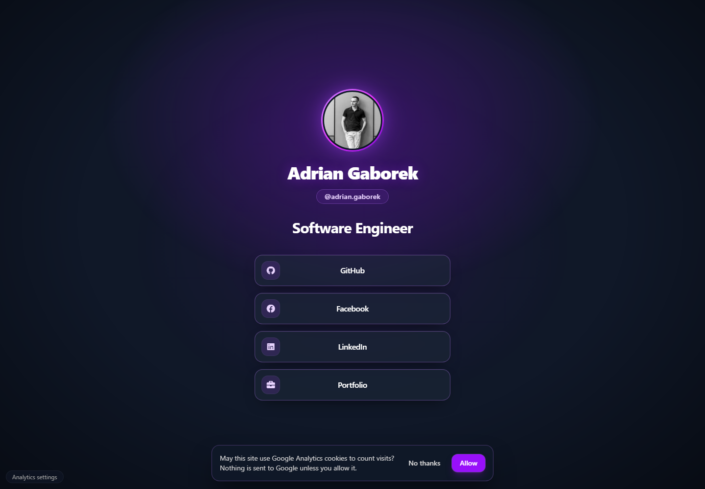

# link-in-bio

A reusable profile page with animated taglines, social links, and certificate pages. Edit the content in
[Storyblok](https://www.storyblok.com). The site runs on Blazor WebAssembly and Azure Static Web Apps.

[Live site](https://adriangaborek.dev/) · [Local setup](#local-setup) · [Storyblok](#storyblok) · [Deployment](#deployment)

[](https://adriangaborek.dev/)

## Local setup

Install the .NET SDK pinned in [global.json](global.json). Add your Storyblok public token to
`Client/wwwroot/appsettings.Development.json` (git ignores this file).

```json
{
  "Storyblok": {
    "ApiKeyPublic": "your public token"
  }
}
```

Run `dotnet run --project Client` and open the address it prints. For local Visual Editor preview, add
`ApiKeyPreview` in the same file and open the site with `?_storyblok`.

## Storyblok

Create a `home` story of type `page`. Allow the nestable `header`, `list`, and `site_settings` blocks in its `body`.
Add a header and a list for the profile content, and one Site Settings block for the site’s identity.

| Field | Type | Purpose |
| --- | --- | --- |
| `display_name` | Text | Profile heading and page title |
| `professional_title` | Text | Role in the page title and structured data |
| `seo_description` | Text | Search and social preview description |
| `social_image` | Asset | Social preview image. Defaults to the header photo. |
| `canonical_url` | Text | Public origin, such as `https://links.example.com`, for canonical metadata and the sitemap |
| `analytics_measurement_id` | Text | GA4 measurement ID |
| `analytics_hosts` | Text | Comma-separated hostnames, without schemes or paths |
| `app_name` | Text | Installed app name. Defaults to “Links”. |
| `app_icon` | Asset | Square PNG at least 512 × 512 for app and Apple touch icons |
| `app_maskable_icon` | Asset | Square PNG at least 512 × 512 with the artwork centered for cropping |

Publish `home` and deploy to refresh the prerendered page, metadata, and install branding. Blank icon fields
keep the bundled icons. Analytics requires both analytics fields and loads only after visitors opt in on a listed host.

## Development

```sh
dotnet test --solution link-in-bio.slnx
npm ci --ignore-scripts
node --test "Tests/js/*.test.mjs"
```

After changing Tailwind classes or `Client/Styles/app.css`, rebuild the committed stylesheet on Linux x64 or WSL.

```sh
.github/scripts/build-app-css.sh Client/wwwroot/css/app.css
```

On other platforms, run `npx @tailwindcss/cli@<version> --input Styles/app.css --output wwwroot/css/app.css --minify`
from `Client`. Use the version pinned in the build script.

| Project | Purpose |
| --- | --- |
| [Client](Client) | Blazor pages, components, and static assets |
| [Storyblok](Storyblok) | Content Delivery API client and Visual Editor support |
| [Prerender](Prerender) | Generates the published homepage and metadata |
| [Api](Api) | Azure Function that starts deploys after Storyblok changes |
| [Tests](Tests) | .NET and JavaScript tests |

## Deployment

The [Azure workflow](.github/workflows/azure-static-web-apps-gray-tree-0c2e88d03.yml) tests changes and deploys
production from `main` and staging for eligible pull requests. Set these repository secrets.

| Secret | Purpose |
| --- | --- |
| `STORYBLOK_API_KEY_PUBLIC` | Published content |
| `STORYBLOK_API_KEY_PREVIEW` | Drafts in the editor deployment |
| `AZURE_STATIC_WEB_APPS_API_TOKEN_GRAY_TREE_0C2E88D03` | Azure deployment |

The build prerenders the homepage so it’s visible before Blazor starts. Certificate and 404 routes use the app
shell. The workflow also checks the published Content Security Policy and uses the `wasm-tools` workload to
reduce the runtime download.

Set the editor deployment URL in Storyblok’s Visual Editor settings and set the Home story’s real path to `/`.
The editor environment exposes its preview token to visitors. Use local preview or restrict access if drafts are private.

### Deploying on a publish in Storyblok

1. Configure the target repositories, workflows, refs, and slug filters in [Api/appsettings.json](Api/appsettings.json).
   Each workflow needs `workflow_dispatch`. Set `DeployTrigger:Sites` to `[]` to skip webhook dispatch.
2. In the production Azure Static Web App environment, set `DeployTrigger__GitHubToken` to a fine-grained token
   with **Actions: read and write** on the target repositories. Set `DeployTrigger__WebhookSecret` to a random secret.
3. In Storyblok, send story publish, unpublish, delete, and move events to
   `https://<your-site>/api/storyblok-webhook?secret=<secret>`. If Cloudflare returns a 403, use the Azure Static Web Apps hostname.

## License

[MIT](LICENSE). Vendored libraries keep their own licenses in [Client/wwwroot/lib](Client/wwwroot/lib).
